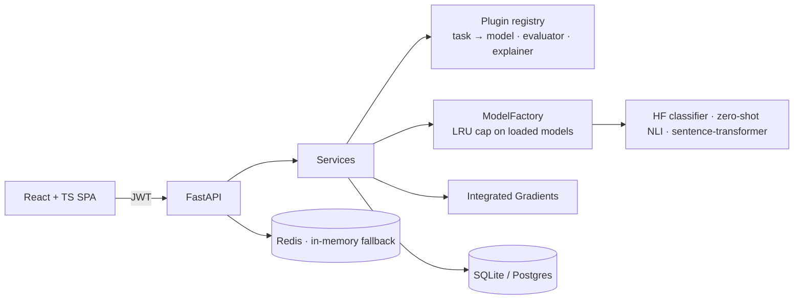

# Enterprise NLP Intelligence Platform

A full-stack platform for serving, evaluating and explaining transformer NLP models.
It serves 8 tasks with real Hugging Face models, including a DistilBERT sentiment model
fine-tuned here on SST-2. Every prediction can be explained with Integrated Gradients,
and every model is scored against a baseline on held-out data, all behind an
authenticated, role-based API with a React UI.


## What it does

| Task | Model | Notes |
|---|---|---|
| Sentiment | DistilBERT, **fine-tuned in this repo** on SST-2 | explainable |
| Emotion | DistilRoBERTa (7 classes) | explainable |
| Toxicity | BERT, multi-label (6 labels) | explainable |
| Topic | RoBERTa, multi-label (19 topics) | |
| Language ID | XLM-RoBERTa (20 languages) | |
| Zero-shot | DeBERTa-v3 NLI, labels chosen per request | |
| Semantic similarity | MiniLM bi-encoder, cosine | |
| Text embeddings | MiniLM, 384-d | also powers semantic dataset search |

Sources, licenses and known failure modes for each model are in [docs/model-cards.md](docs/model-cards.md).

## Results

**Sentiment, SST-2 validation (872 sentences) and the 48-sentence challenge set** (negation, sarcasm, mixed sentiment):

RESULTS_TABLE

**CPU inference, FP32 vs dynamic INT8 quantization:**

BENCHMARK_TABLE

Reproduce with `python scripts/evaluate_sentiment.py` and `python scripts/benchmark_inference.py`.
Raw numbers are in [reports/](reports/) and [benchmarks/](benchmarks/).

## Architecture



Layered as API → services → repositories / NLP, with strategy + factory for models and
a plugin registry for tasks: adding a task is one registration and needs no core changes.
Details: [docs/architecture-guide.md](docs/architecture-guide.md).

## Engineering highlights

- **Fine-tuning pipeline**: an HF `Trainer` implementation of a platform `BaseTrainer`
  that writes metrics, config and a model card next to the checkpoint. The API serves
  the result automatically.
- **Integrated Gradients written directly in PyTorch**: batched path integral over input
  embeddings, sub-word → word merging, and a reported completeness gap so you can tell
  how faithful an explanation is. It is unit-tested on a tiny BERT built in-process.
- **Evaluation against a floor**: the served model and a lexicon baseline run on the
  same data (SST-2, a targeted challenge set, or any uploaded dataset) through the same
  scikit-learn metrics, error analysis and calibration code.
- **Serving that respects memory**: lazy loading, an LRU cap on resident models, padded
  batch inference, retry with backoff on Hub downloads, one worker per container
  (workers multiply model memory).
- **Production plumbing**: JWT with rotating hashed refresh tokens, account lockout,
  9-role RBAC with separation of duties on model approval, an audit trail, Redis rate
  limiting with in-memory fallback, a model registry with promotion/rollback rules, and
  a 10-endpoint health suite.
- **Supply chain**: `pip-audit` reports 0 known vulnerabilities after migrating
  python-jose → PyJWT and upgrading FastAPI/Starlette; frontend production dependencies
  report 0 too.
- **Tests that don't lie**: TEST_COUNTS. Unit tests never touch the network (an autouse
  fake model); `pytest -m integration` checks real checkpoints on unambiguous inputs.

## Quickstart

```bash
# Backend
python -m venv .venv && source .venv/bin/activate       # Windows: .venv\Scripts\activate
pip install torch --index-url https://download.pytorch.org/whl/cpu
pip install -r requirements-ml.txt
cp .env.example .env
uvicorn backend.main:app --reload                        # http://localhost:8000/docs

# Frontend
cd frontend && npm install && npm run dev                # http://localhost:5173
```

In development a bootstrap account is seeded: `admin` / `ChangeMe123!`. It is never
created in production. Models download on first use (~2.5GB for all eight).

Or with Docker: `docker compose -f docker/docker-compose.yml --profile prod up --build`.

## Train, evaluate, benchmark

```bash
python scripts/train_sentiment.py          # fine-tune DistilBERT on SST-2 (TRAIN_TIME on a 16-thread CPU)
python scripts/evaluate_sentiment.py       # baseline vs public checkpoint vs ours
python scripts/benchmark_inference.py      # latency / throughput / accuracy, FP32 vs INT8
python scripts/load_test.py --base-url http://127.0.0.1:8000
```

## Tests

```bash
pytest                       # backend unit tests (~2 min, no network)
pytest -m integration        # real models
cd frontend && npm test && npm run lint && npm run build
```

CI ([.github/workflows/ci.yml](.github/workflows/ci.yml)) runs all of the above plus
`pip-audit` and Docker builds.

## API at a glance

```bash
TOKEN=$(curl -s localhost:8000/api/v1/auth/login -H 'content-type: application/json' \
  -d '{"username":"admin","password":"ChangeMe123!"}' | jq -r .access_token)

curl -s localhost:8000/api/v1/explain -H "authorization: Bearer $TOKEN" -H 'content-type: application/json' \
  -d '{"task":"sentiment_analysis","text":"The plot was dull but the acting was brilliant."}'
```

| Endpoint | Purpose |
|---|---|
| `POST /predict`, `/predict/batch` | Inference for any task |
| `POST /explain` | Integrated Gradients word attributions |
| `POST /embed` | Sentence embeddings |
| `POST /evaluation/run` | Score a model on a benchmark or uploaded dataset |
| `/datasets/*` | Upload, validate, profile, version, semantic search |
| `/models/*` | Registry: register → approve → promote → deploy → champion |
| `/health`, `/status`, `/metrics` | Health suite and inference metrics |

Full reference: [docs/api-documentation.md](docs/api-documentation.md), or `/docs` on a running server.

## Project layout

```
backend/
  api/v1/endpoints/   HTTP layer
  services/           orchestration and business rules
  nlp/inference/      model strategies, factory, Hub loading
  nlp/training/       BaseTrainer + Hugging Face Trainer implementation
  explainability/     Integrated Gradients
  evaluation/         metrics, error analysis, baseline, run store
  plugins/            task registrations
  auth/ core/ config/ database/ models/ repositories/ schemas/
frontend/             React + TypeScript + Vite
scripts/              train, evaluate, benchmark, load test, screenshots
tests/                pytest (unit + integration)
docs/                 architecture, API, model cards, deployment, security
deployment/k8s/       Kubernetes manifests
docker/               Dockerfiles + Compose
```

## Limitations and roadmap

- Only the sentiment model is fine-tuned here; the other tasks serve public checkpoints.
- CPU-first: no GPU serving, no dynamic request batching across clients, and no ONNX
  Runtime path yet.
- Vector indices are in-memory per process (pgvector is the next step).
- No MFA, password reset or email verification.
- No distributed job queue, scheduled re-evaluation, tracing or Prometheus endpoint.
- Monitoring and Admin pages in the UI are placeholders.

## License

MIT
