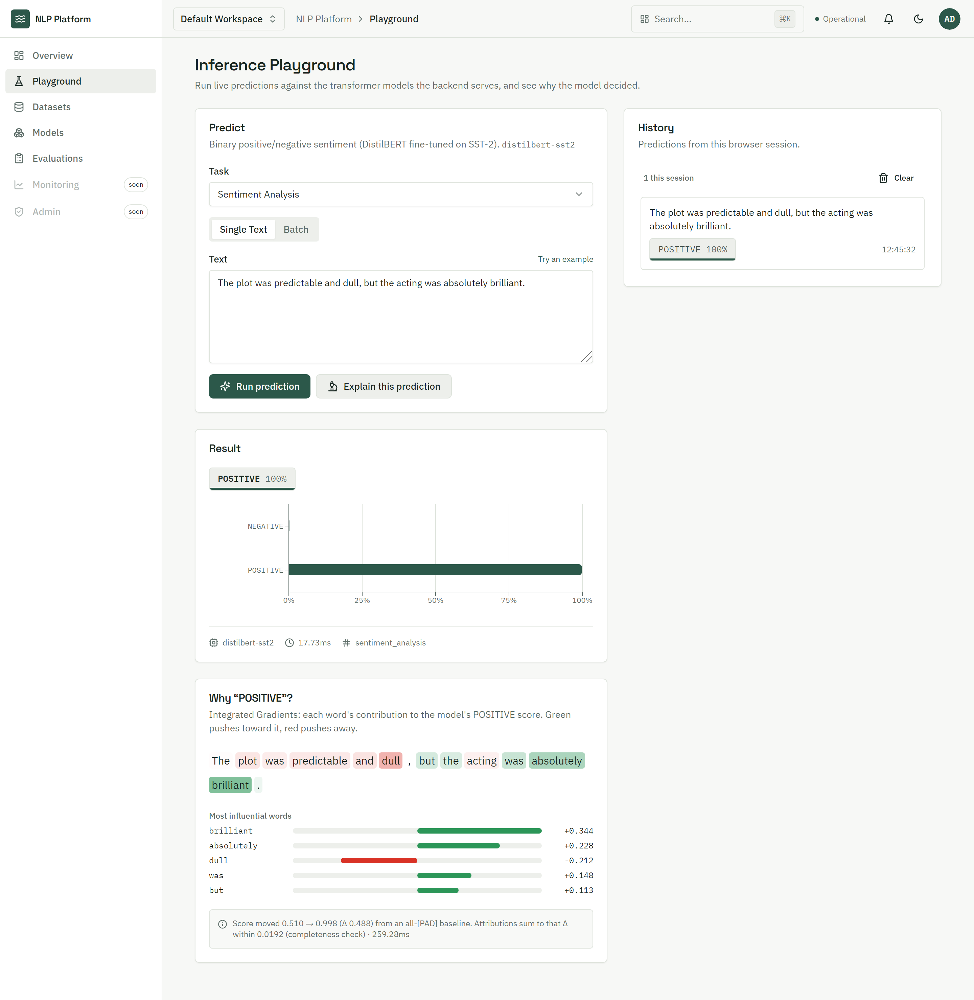
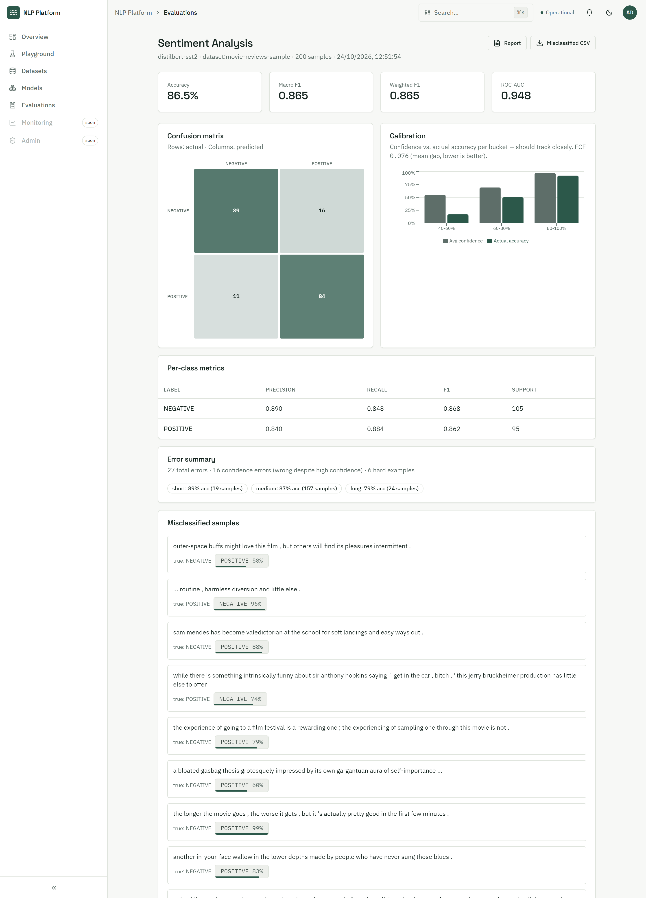
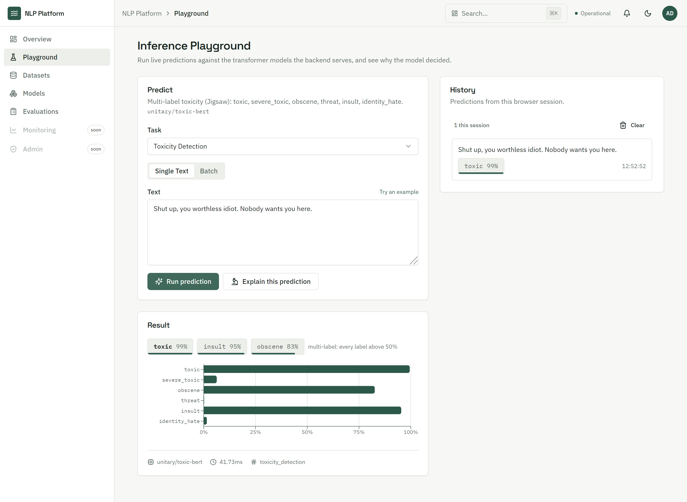
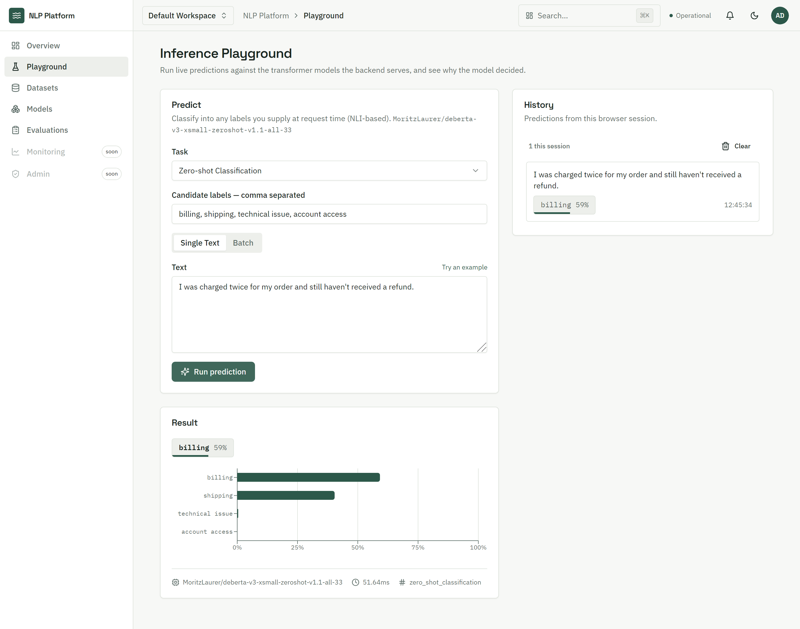
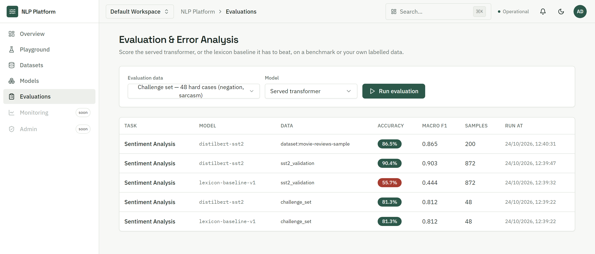
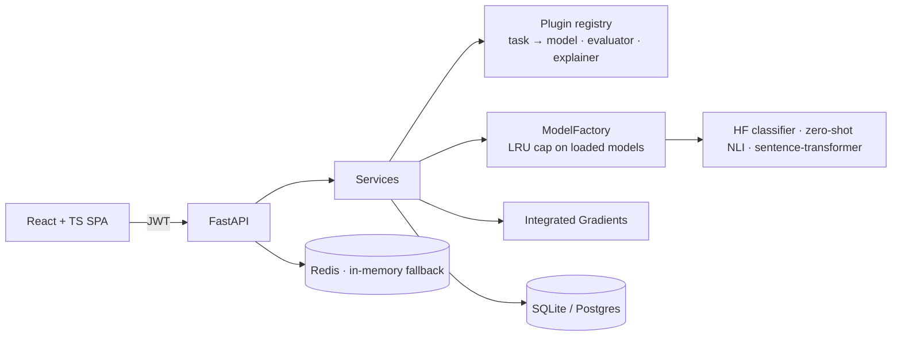

# Enterprise NLP Intelligence Platform

A full-stack platform for serving, evaluating and explaining transformer NLP models.
It serves 8 tasks with real Hugging Face models, including a DistilBERT sentiment model
fine-tuned here on SST-2. Classifier predictions can be explained word by word with
Integrated Gradients, and any single-label model can be scored on held-out or uploaded
data, all behind an authenticated, role-based API with a React UI.

**Live demo: [enterprise-nlp.vercel.app](https://enterprise-nlp.vercel.app)** — choose *Explore the live demo*. It runs the
fine-tuned sentiment model with explanations and MiniLM similarity on a free 512 MB instance; see [Hosted demo](#hosted-demo).



## What it does

| Task | Model | Notes |
|---|---|---|
| Sentiment | DistilBERT, **fine-tuned in this repo** on SST-2 | explainable |
| Emotion | DistilRoBERTa (7 classes) | explainable |
| Toxicity | BERT, multi-label (6 labels) | explainable |
| Topic | RoBERTa, multi-label (19 topics) | |
| Language ID | XLM-RoBERTa (20 languages) | |
| Zero-shot | DeBERTa-v3 NLI, labels chosen per request | |
| Semantic similarity | MiniLM bi-encoder, cosine | |
| Text embeddings | MiniLM, 384-d | also powers semantic dataset search |

Sources, licenses and known failure modes for each model are in [docs/model-cards.md](docs/model-cards.md).

## Results

**Sentiment, SST-2 validation (872 sentences) and the 48-sentence challenge set** (negation, sarcasm, mixed sentiment):

| System | SST-2 accuracy | SST-2 macro-F1 | Challenge set accuracy |
|---|---|---|---|
| Lexicon baseline (bag-of-words + negation) | 55.73% | 0.444 | 81.25% |
| DistilBERT, public SST-2 checkpoint | 91.06% | 0.910 | 87.50% |
| **DistilBERT, fine-tuned here** | 90.37% | 0.903 | 81.25% |

Our model also has ROC-AUC 0.970 and calibration error (ECE) 0.045 on SST-2. It was trained
for one epoch on the full 67k-sentence train split, on a laptop CPU in 92 minutes.

**What the numbers say:**
- The lexicon baseline is near chance on real text (55.7%), and both transformers clear 90%.
- The challenge set flatters the baseline because it was written alongside the lexicon's
  word lists. It's a diagnostic, not a benchmark.
- **Sarcasm is the shared blind spot.** "Love how it stopped working after just two days.
  Fantastic." is POSITIVE at 0.99 confidence for both transformers. Per-sentence breakdown:
  [reports/sentiment_error_analysis.md](reports/sentiment_error_analysis.md).

**CPU inference, FP32 vs dynamic INT8 quantization:**

| Variant | Size | p50 latency, batch 1 | Throughput, batch 32 | SST-2 accuracy |
|---|---|---|---|---|
| fp32 | 268 MB | 18.5 ms | 42 texts/s | 90.37% |
| int8-dynamic | 139 MB | 23.7 ms | 123 texts/s | 88.99% |

INT8 halves the model and roughly triples batch throughput for −1.4 accuracy points, but it's
*slower* for single texts, because quantizing activations on the fly costs more than it saves
on tiny inputs. Use it for batch jobs and keep FP32 for interactive latency. Medians of 5
alternating rounds on an Intel Core Ultra 9 185H laptop.

**Served end to end** (`scripts/load_test.py`, one uvicorn worker): `POST /predict` sentiment at
**17.8 ms p50 / 55 req/s**. The first load test measured 165 ms because of a `gc.collect()`
on every model lookup. Finding and fixing that is written up in the
[testing guide](docs/testing-and-qa-guide.md#load-testing-scriptsload_testpy).

Reproduce with `python scripts/evaluate_sentiment.py` and `python scripts/benchmark_inference.py`.
Raw numbers are in [reports/](reports/) and [benchmarks/](benchmarks/).

## Screenshots

| Evaluation run: confusion matrix, calibration, misclassified samples | Multi-label toxicity |
|---|---|
|  |  |
| **Zero-shot with labels chosen per request** | **Model vs baseline across datasets** |
|  |  |

## Architecture



Layered as API → services → repositories / NLP, with strategy + factory for models and
a plugin registry for tasks: adding a task is one registration and needs no core changes.
Details: [docs/architecture-guide.md](docs/architecture-guide.md).

## Engineering highlights

- **Fine-tuning pipeline**: an HF `Trainer` implementation of a platform `BaseTrainer`
  that writes metrics, config and a model card next to the checkpoint. The API serves
  the result automatically.
- **Integrated Gradients written directly in PyTorch**: batched path integral over input
  embeddings, sub-word → word merging, and a reported completeness gap so you can tell
  how faithful an explanation is. It is unit-tested on a tiny BERT built in-process.
- **Evaluation against a floor**: the served model and a lexicon baseline run on the
  same data (SST-2, a targeted challenge set, or any uploaded dataset) through the same
  scikit-learn metrics, error analysis and calibration code.
- **Serving that respects memory**: lazy loading, an LRU cap on resident models, padded
  batch inference, retry with backoff on Hub downloads, one worker per container
  (workers multiply model memory).
- **Production plumbing**: JWT with rotating hashed refresh tokens, account lockout,
  9-role RBAC with separation of duties on model approval, an audit trail, Redis rate
  limiting with in-memory fallback, a model registry with promotion/rollback rules, and
  a 10-endpoint health suite.
- **Supply chain**: `pip-audit` reports 0 known vulnerabilities after migrating
  python-jose → PyJWT and upgrading FastAPI/Starlette; frontend production dependencies
  report 0 too.
- **Tests at three levels**: 175 backend unit/API tests that never touch the network (an
  autouse fake model), 14 integration tests on the real checkpoints, and 33 frontend tests,
  including one that mounts the whole app shell. Driving the real UI with Playwright found
  two bugs no unit test had caught: a provider-wiring crash after login, and mislabelled
  calibration buckets. Both are fixed and covered by tests now.

## Hosted demo

The [live demo](https://enterprise-nlp.vercel.app) runs on free hosting: the React app on Vercel, which proxies `/api/*` to
the API on Render's free tier (512 MB of memory, a tenth of a CPU). All 8 models need about 2–3 GB, so the demo serves the
two that fit and shows the other five tasks as available in the full deployment:

- **Served:** sentiment with the DistilBERT fine-tuned here (Integrated Gradients explanations included), semantic similarity
  and embeddings (MiniLM, which also powers dataset search). `GET /tasks` lists what an instance serves and, under
  `not_served`, what it doesn't, so the UI says so instead of failing.
- **Pre-built at image build time** ([scripts/demo_build.py](scripts/demo_build.py)): the fine-tuned model and the lexicon
  baseline evaluated on the challenge set and the full SST-2 validation split, the model taken through approval →
  production → deployed → champion, and a 200-sentence dataset uploaded and evaluated. The fine-tuned weights come from this
  repository's GitHub release and are verified by SHA-256 before use ([scripts/fetch_model.py](scripts/fetch_model.py)).
- **Sized for the instance:** measured under a 512 MB, no-swap, 10%-CPU cgroup. Models load in the background at
  startup, one at a time; explanations run in chunks of 4 interpolation steps with at most 16 steps (same attributions,
  bounded memory; the response still reports the convergence delta); evaluations batch 8 texts and the served model is
  evaluated on at most 100 examples per request; the SST-2 split is read from a JSON export, so `datasets` and pyarrow
  are not in the runtime image.
- **Sign-in:** *Explore the live demo* (`POST /api/v1/auth/guest`, off unless `GUEST_ACCESS_ENABLED=true`, rate-limited)
  signs visitors in as a shared `data_scientist`: run models, upload datasets, run evaluations; no administration or audit
  log. Self-registration is off and every pre-existing account gets a random password at startup; the owner's
  administrator comes from hosting secrets (`NLP_ADMIN_USERNAME`, `NLP_ADMIN_PASSWORD`).
- **Reset:** every start copies the showcase afresh ([scripts/demo_start.py](scripts/demo_start.py)). The free instance
  sleeps when idle, so the first visit after a pause takes a minute or two, and explanations take several seconds on a
  tenth of a CPU.

Deploy files: [render.yaml](render.yaml), [deploy/demo/Dockerfile](deploy/demo/Dockerfile),
[frontend/vercel.json](frontend/vercel.json). A full deployment uses [docker/](docker/) or [deployment/k8s/](deployment/k8s/).

## Quickstart

```bash
# Backend
python -m venv .venv && source .venv/bin/activate       # Windows: .venv\Scripts\activate
pip install torch --index-url https://download.pytorch.org/whl/cpu
pip install -r requirements-ml.txt
cp .env.example .env
uvicorn backend.main:app --reload                        # http://localhost:8000/docs

# Frontend
cd frontend && npm install && npm run dev                # http://localhost:5173
```

In development a bootstrap account is seeded: `admin` / `ChangeMe123!`. It is never
created in production. Models download on first use (~2.5GB for all eight). To fill the UI
with real evaluation runs, a deployed model and a dataset, run `python scripts/seed_demo.py`.

Or with Docker: `docker compose -f docker/docker-compose.yml --profile prod up --build`.

## Train, evaluate, benchmark

```bash
python scripts/train_sentiment.py          # fine-tune DistilBERT on SST-2 (92 min on a laptop CPU, minutes on a GPU)
python scripts/evaluate_sentiment.py       # baseline vs public checkpoint vs ours
python scripts/benchmark_inference.py      # latency / throughput / accuracy, FP32 vs INT8
python scripts/load_test.py --base-url http://127.0.0.1:8000
```

## Tests

```bash
pytest                       # backend unit tests (~2 min, no network)
pytest -m integration        # real models
cd frontend && npm test && npm run lint && npm run build
```

CI ([.github/workflows/ci.yml](.github/workflows/ci.yml)) runs all of the above plus
`pip-audit` and Docker builds.

## API at a glance

```bash
TOKEN=$(curl -s localhost:8000/api/v1/auth/login -H 'content-type: application/json' \
  -d '{"username":"admin","password":"ChangeMe123!"}' | jq -r .access_token)

curl -s localhost:8000/api/v1/explain -H "authorization: Bearer $TOKEN" -H 'content-type: application/json' \
  -d '{"task":"sentiment_analysis","text":"The plot was dull but the acting was brilliant."}'
```

| Endpoint | Purpose |
|---|---|
| `POST /predict`, `/predict/batch` | Inference for any task |
| `POST /explain` | Integrated Gradients word attributions |
| `POST /embed` | Sentence embeddings |
| `POST /evaluation/run` | Score a model on a benchmark or uploaded dataset |
| `/datasets/*` | Upload, validate, profile, version, semantic search |
| `/models/*` | Registry: register → approve → promote → deploy → champion |
| `/health`, `/status`, `/metrics` | Health suite and inference metrics |

Full reference: [docs/api-documentation.md](docs/api-documentation.md), or `/docs` on a running server.

## Project layout

```
backend/
  api/v1/endpoints/   HTTP layer
  services/           orchestration and business rules
  nlp/inference/      model strategies, factory, Hub loading
  nlp/training/       BaseTrainer + Hugging Face Trainer implementation
  explainability/     Integrated Gradients
  evaluation/         metrics, error analysis, baseline, run store
  plugins/            task registrations
  auth/ core/ config/ database/ models/ repositories/ schemas/
frontend/             React + TypeScript + Vite
scripts/              train, evaluate, benchmark, load test, screenshots
tests/                pytest (unit + integration)
docs/                 architecture, API, model cards, deployment, security
deployment/k8s/       Kubernetes manifests
docker/               Dockerfiles + Compose
```

## Limitations and roadmap

- Only the sentiment model is fine-tuned here; the other tasks serve public checkpoints.
- CPU-first: no GPU serving, no server-side micro-batching across clients, no
  length-bucketed batching (padding waste caps batch-32 FP32 gains), and no ONNX Runtime path yet.
- Vector indices are in-memory per process (pgvector is the next step).
- No MFA, password reset or email verification.
- No distributed job queue, scheduled re-evaluation, tracing or Prometheus endpoint.
- Monitoring counters live in the API process and reset on restart; the Admin page is an audit-log viewer (user and role
  management are API-only).

## License

MIT
