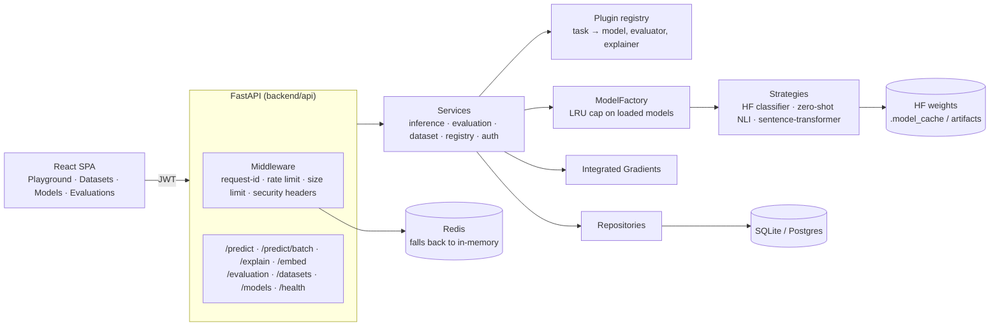

# Architecture Guide

## System overview



## Layers

```
API layer          backend/api/            HTTP only: parse, authorise, call a service, serialise
Service layer      backend/services/       Orchestration and business rules
NLP subsystem      backend/nlp/            Model strategies, factory, training, embeddings
Explainability     backend/explainability/ Integrated Gradients over input embeddings
Evaluation         backend/evaluation/     sklearn metrics, error analysis, baseline, run store
Repository layer   backend/repositories/   Data access; hides SQLAlchemy from services
Database layer     backend/database/       Engine, session, ORM base, seed
Core               backend/core/           Exceptions, DI container, middleware, cache, resilience
Config             backend/config/         Typed settings per environment, structured logging
```

Dependencies only point downward (API → Service → Repository / NLP → Database / Core).
Nothing in `core/` or `config/` imports from a layer above it.

## How a prediction flows

1. `POST /predict {task, text}` → auth dependency decodes the JWT, RBAC checks `model:infer`.
2. `InferenceService` looks the task up in the **plugin registry** to get its default
   architecture and checkpoint.
3. `ModelFactory.get_model(architecture, name, task)` returns a cached strategy instance.
   Zero-shot is routed to `ZeroShotModel` regardless of encoder; everything else maps by
   architecture. If more than `MAX_LOADED_MODELS` models now hold weights, the least
   recently used one is unloaded.
4. The strategy lazily loads weights on first use, tokenises with truncation to the
   model's max length, and runs one forward pass under `torch.inference_mode()`.
   Single-label heads use softmax; heads whose config says
   `problem_type="multi_label_classification"` use per-label sigmoid and return every
   label over 0.5.
5. Latency and success are recorded in the metrics registry (`/monitoring`).

`/predict/batch` pads and stacks up to `INFERENCE_BATCH_SIZE` texts per forward pass.

## Explainability

`/explain` runs Integrated Gradients (`backend/explainability/integrated_gradients.py`)
directly against the served model's input embeddings: 32 interpolation steps from an
all-`[PAD]` baseline (special tokens kept) to the real input, batched into one
forward/backward pass, trapezoid-rule integration, then sub-word scores summed back into
words via the fast tokenizer's alignment. The response includes the completeness gap
(`Σ attributions − (F(x) − F(baseline))`) so the caller can see how faithful the
approximation is.

## Training

`HFSequenceClassificationTrainer` (`backend/nlp/training/hf_trainer.py`) implements the
`BaseTrainer` contract on top of `transformers.Trainer`: seeded shuffling, dynamic padding,
linear warm-up, per-epoch evaluation, and a final evaluation through the *same* metrics
code the API uses. It writes `metrics.json`, `training_config.json` and a model card
next to the checkpoint. `scripts/train_sentiment.py` is the CLI; when
`artifacts/models/distilbert-sst2/` exists, the sentiment plugin serves it instead of
the public checkpoint.

## Design patterns and where they live

| Pattern | Where | Why |
|---|---|---|
| Strategy | `backend/nlp/inference/base_model.py` | Every model backend is interchangeable behind `predict` / `predict_batch` |
| Factory (+ LRU cache) | `backend/nlp/inference/model_factory.py` | One place maps architecture → class and bounds memory |
| Plugin registry | `backend/plugins/` | Adding a task is one registration, no core edits |
| Repository | `backend/repositories/` | Services never touch SQLAlchemy directly |
| Service layer | `backend/services/` | Endpoints stay thin; logic is unit-testable without HTTP |
| Adapter | `backend/nlp/tokenization/tokenizer_factory.py` | Third-party tokenizer API behind a platform interface |
| Dependency injection | FastAPI `Depends` + `backend/core/container.py` | Request-scoped and app-scoped wiring |

## Extending the platform

### Add a new NLP task
1. Add the value to `NLPTask` (`backend/core/constants.py`).
2. Register a `TaskPlugin` in `backend/plugins/__init__.py` with its default
   architecture and checkpoint (and an explainer, if the head is a sequence classifier).
3. `/predict`, `/predict/batch`, `/tasks` and the Playground pick it up automatically.

### Add a new encoder architecture
Most `AutoModelForSequenceClassification` checkpoints need no new code: add one line to
`_ARCHITECTURE_REGISTRY` mapping the architecture to `BertModel`. A genuinely different
inference procedure (as zero-shot is) gets its own strategy class.

### Add a new persisted domain object
1. ORM model in `backend/models/` subclassing `Base`.
2. Repository in `backend/repositories/` subclassing `BaseRepository`.
3. Service in `backend/services/` that uses it.

## Testing strategy

- **Unit tests** (`pytest`) run in under two minutes with no network: an autouse fixture
  replaces `ModelFactory.get_model` with a deterministic fake. Integrated Gradients is
  still tested for real against a tiny randomly initialised BERT built in-process.
- **Integration tests** (`pytest -m integration`) load every real checkpoint and assert
  behaviour on unambiguous inputs (e.g. French text → `fr`, paraphrase similarity >
  word-overlap similarity). CI runs them on pushes to `main` with a cached model directory.
