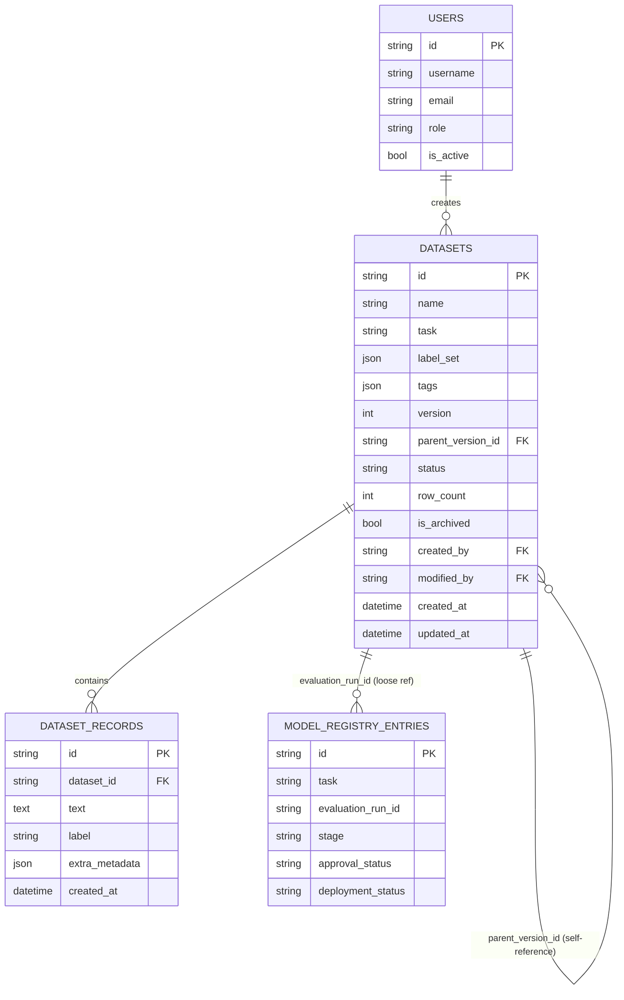

# Data Platform Guide

Covers `backend/datasets/`, `backend/models/dataset*.py`,
`backend/services/dataset_service.py`, and the embedding index
(`backend/services/embedding_service.py`). See `docs/architecture-guide.md`
for the platform's overall layering — this doc is scoped to the data layer.

## Database architecture

- **SQLite** (dev default) and **PostgreSQL** are both supported through
  the same code path — `backend/database/session.py` picks connection
  args based on the `DATABASE_URL` scheme, and every model uses portable
  SQLAlchemy column types (no SQLite-only constructs). Switching is just
  `DATABASE_URL=postgresql://...` + the `psycopg2-binary` driver (now a
  dependency) — verified in this build by constructing a real engine
  against a `postgresql://` URL and confirming SQLAlchemy resolves the
  dialect correctly. **Not verified**: an actual running Postgres
  instance — there's no persistent background service across tool calls
  in this sandbox to test against, so this is a code-level guarantee, not
  a live integration test.
- **Redis (caching)** and a **vector database** are architectural targets,
  not implemented — see PROJECT_STATUS.md. The embedding index
  (`EmbeddingIndexService`) already isolates "fitted vectors for one
  dataset" behind a small interface specifically so the in-memory storage
  can be swapped for FAISS/pgvector/Pinecone later without changing its
  callers.

## Entity-relationship diagram

Scoped to the tables added in this pass, plus how they relate to what
already existed (`users`, `model_registry_entries`, `refresh_tokens`).

## Data dictionary

### `datasets`
| Column | Type | Notes |
|---|---|---|
| `id` | UUID string | |
| `name` / `task` | string | `task` matches an `NLPTask` value |
| `label_set` | JSON array | declared valid labels; used by validation |
| `tags` | JSON array | free-form, filterable via `GET /datasets?tag=` |
| `version` / `parent_version_id` | int / UUID string | see Versioning below |
| `status` | `draft` \| `validated` \| `archived` | `validated` only after an upload with no blocking issues |
| `row_count` | int | denormalized from `dataset_records` for cheap listing |
| `is_archived` / `archived_at` | bool / datetime | soft delete — never a hard `DELETE` |
| `created_by` / `modified_by` | UUID string | references `users.id` (no FK constraint — see note below) |

### `dataset_records`
| Column | Type | Notes |
|---|---|---|
| `dataset_id` | UUID string, FK | |
| `text` | text | post-cleaning, if cleaning was applied on upload |
| `label` | string, nullable | |
| `extra_metadata` | JSON | currently just `{"cleaned": bool}`; open for future per-record annotation metadata |

**Note on `created_by`/`modified_by`**: these store a user id as a plain
string rather than a SQLAlchemy `ForeignKey` to `users.id`. That's a
deliberate, documented shortcut for this pass, not an oversight — adding
the FK constraint is a one-line change but wasn't required for anything
built so far to function correctly.

## Versioning & lineage

A new version is a full copy: a new `Dataset` row with `version` +1 and
`parent_version_id` pointing at the source, plus a copy of every
`DatasetRecord`. `GET /datasets/{id}/versions` walks the
`parent_version_id` chain back to the root and returns the whole history
oldest-first.

This is a simple-but-real design, not a placeholder: it genuinely answers
"what did this dataset look like at version N" (query that version's
records directly) and "what's the lineage" (walk the chain). It does NOT
do field-level diffing between versions (e.g. "which 12 records changed
between v1 and v2") — `GET /datasets/compare/{a}/{b}` compares aggregate
stats (row count, vocabulary size, label distribution), not a per-record
diff. A production system with very large datasets would likely want
copy-on-write / delta storage instead of full copies; this platform's
datasets are small enough that full copies are the right-sized tradeoff.

**Lineage beyond dataset versions** (upload → cleaning → validation →
training → evaluation → deployment) is traceable by following IDs across
tables that already exist (`Dataset.id` → `ModelRegistryEntry.evaluation_run_id`
→ evaluation run JSON), but there's no single "lineage graph" API that
assembles this automatically yet — see PROJECT_STATUS.md.

## Embedding guide

`backend/nlp/embeddings/tfidf_embedder.py` implements the platform's
`BaseEmbedder` interface using scikit-learn TF-IDF vectors (no HF Hub
access in this sandbox — see PROJECT_STATUS.md for why this isn't a
neural sentence-transformer). For anything beyond a single
similarity-between-two-strings comparison, use
`backend.services.embedding_service.embedding_index_service` instead: it
fits one vectorizer over an entire dataset's records (`POST
/datasets/{id}/embeddings/build`) and supports real cosine-similarity
search (`GET /datasets/{id}/embeddings/search`) and pairwise similarity
(`GET /datasets/{id}/embeddings/similarity`) against that fitted space.

The index lives in memory, keyed by dataset id, for the lifetime of the
process — rebuilding after new records are uploaded is currently manual
(call `/build` again), not automatic.

## What's NOT in this pass

See PROJECT_STATUS.md for the full list; the data-platform-specific gaps:
annotation/human-review workflows, dataset search beyond name/description/tag
(no semantic dataset search), backup/recovery, encryption-at-rest for
dataset content, a dedicated audit-log table for dataset changes (structured
logs capture these, but nothing queryable), and real data augmentation
methods that need a model (back-translation, neural paraphrasing).
