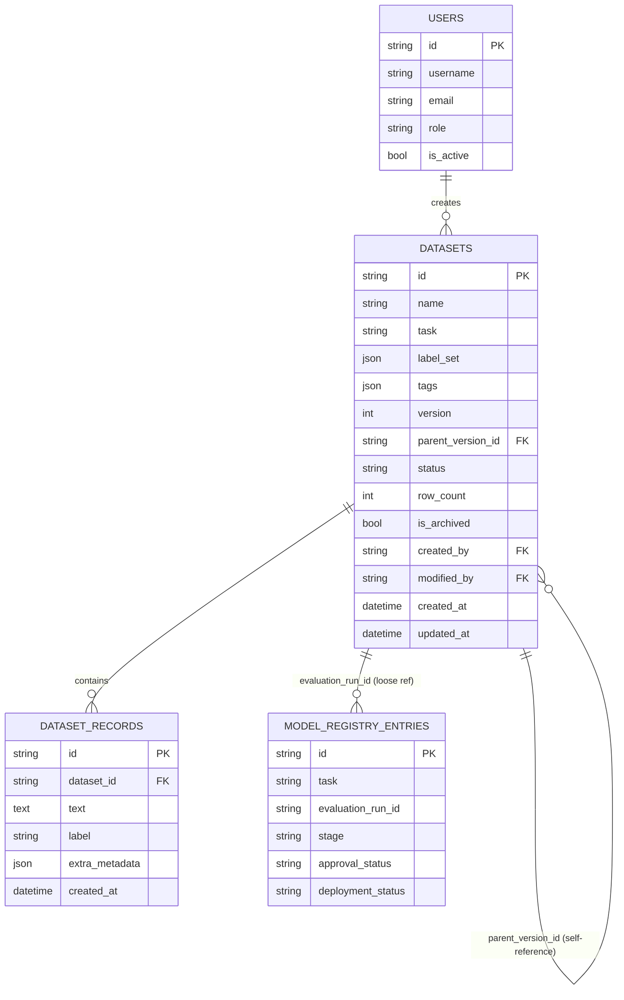

# Data Platform Guide

Covers `backend/datasets/`, `backend/models/dataset*.py`,
`backend/services/dataset_service.py`, and the embedding index
(`backend/services/embedding_service.py`). See `docs/architecture-guide.md`
for the platform's overall layering — this doc is scoped to the data layer.

## Database architecture

- **SQLite** (dev default) and **PostgreSQL** are both supported through
  the same code path — `backend/database/session.py` picks connection
  args based on the `DATABASE_URL` scheme, and every model uses portable
  SQLAlchemy column types (no SQLite-only constructs). Switching is just
  `DATABASE_URL=postgresql://...` with the bundled `psycopg2-binary` driver.
  The test suite runs on SQLite; the `prod-postgres` compose profile is the
  path for running against Postgres.
- **Redis** backs caching and rate limiting, with an automatic in-memory
  fallback (`backend/core/cache.py`).
- **Vectors** live in an in-memory, per-dataset index
  (`EmbeddingIndexService`). Exact search is fast enough at the 50k-row
  upload cap; the index is isolated behind a small interface so it can move
  to pgvector or FAISS without changing callers.

## Entity-relationship diagram

The data-platform tables and how they relate to `users` and
`model_registry_entries`.

## Data dictionary

### `datasets`
| Column | Type | Notes |
|---|---|---|
| `id` | UUID string | |
| `name` / `task` | string | `task` matches an `NLPTask` value |
| `label_set` | JSON array | declared valid labels; used by validation |
| `tags` | JSON array | free-form, filterable via `GET /datasets?tag=` |
| `version` / `parent_version_id` | int / UUID string | see Versioning below |
| `status` | `draft` \| `validated` \| `archived` | `validated` only after an upload with no blocking issues |
| `row_count` | int | denormalized from `dataset_records` for cheap listing |
| `is_archived` / `archived_at` | bool / datetime | soft delete — never a hard `DELETE` |
| `created_by` / `modified_by` | UUID string | references `users.id` (no FK constraint — see note below) |

### `dataset_records`
| Column | Type | Notes |
|---|---|---|
| `dataset_id` | UUID string, FK | |
| `text` | text | post-cleaning, if cleaning was applied on upload |
| `label` | string, nullable | |
| `extra_metadata` | JSON | currently just `{"cleaned": bool}`; open for future per-record annotation metadata |

**Note on `created_by`/`modified_by`**: these store a user id as a plain
string rather than a SQLAlchemy `ForeignKey` to `users.id`, so deleting a
user never cascades into dataset history. Adding the constraint is a
one-line change if referential integrity matters more than that.

## Versioning & lineage

A new version is a full copy: a new `Dataset` row with `version` +1 and
`parent_version_id` pointing at the source, plus a copy of every
`DatasetRecord`. `GET /datasets/{id}/versions` walks the
`parent_version_id` chain back to the root and returns the whole history
oldest-first.

This answers
"what did this dataset look like at version N" (query that version's
records directly) and "what's the lineage" (walk the chain). It does NOT
do field-level diffing between versions (e.g. "which 12 records changed
between v1 and v2") — `GET /datasets/compare/{a}/{b}` compares aggregate
stats (row count, vocabulary size, label distribution), not a per-record
diff. A production system with very large datasets would likely want
copy-on-write / delta storage instead of full copies; this platform's
datasets are small enough that full copies are the right-sized tradeoff.

**Lineage beyond dataset versions** (upload → cleaning → validation →
training → evaluation → deployment) is traceable by following IDs across
tables that already exist (`Dataset.id` → `ModelRegistryEntry.evaluation_run_id`
→ evaluation run JSON), but there's no single "lineage graph" API that
assembles it automatically yet.

## Embedding guide

`EmbeddingIndexService` (`backend/services/embedding_service.py`) encodes a
dataset's records once (`POST /datasets/{id}/embeddings/build`) and serves
top-k search (`GET .../embeddings/search`) and pairwise similarity
(`GET .../embeddings/similarity`) against that index.

Two encoders sit behind it:

| Encoder | Model | Finds | Needs |
|---|---|---|---|
| `dense` (default) | `sentence-transformers/all-MiniLM-L6-v2`, 384-d | paraphrases with no shared words ("lasts all day" ↔ "great battery life") | ML extras |
| `tfidf` | word 1–2-gram TF-IDF | exact-term overlap | nothing extra |

Vectors are L2-normalised, so cosine similarity is a dot product, and top-k
uses `argpartition` (O(n)) before sorting only the winners.

The index lives in memory, keyed by dataset id, for the lifetime of the
process — rebuilding after new records are uploaded is currently manual
(call `/build` again), not automatic.

## Not yet supported

Annotation / human-review workflows, persisting vector indices across
restarts, backup/recovery, encryption-at-rest for dataset content, and
model-based augmentation (back-translation, paraphrasing).
